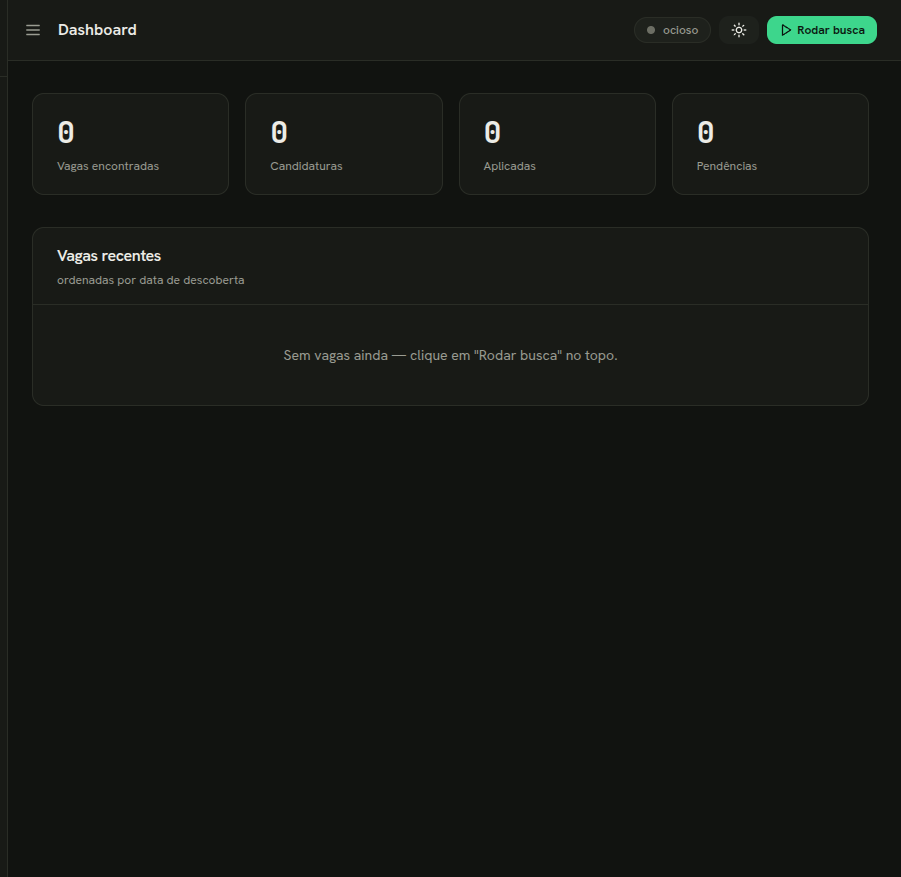
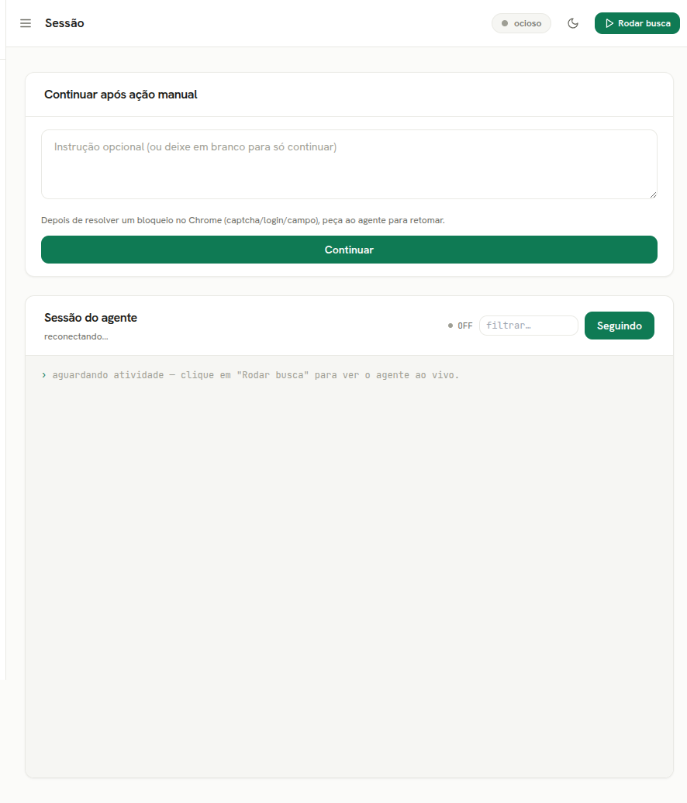

<div align="center">

# jobRabbit 🐇

**Auto-apply to jobs from your terminal — driven by Claude Code + your real Chrome.**

**English** · [Português 🇧🇷](README.pt-BR.md)

[](https://www.rust-lang.org/)
[](https://react.dev/)
[](https://www.typescriptlang.org/)
[](https://vitejs.dev/)
[](https://www.sqlite.org/)
[](https://www.docker.com/)
[](https://www.kernel.org/)
[](https://www.apple.com/macos/)
[](https://www.microsoft.com/windows/)
[](https://claude.com/claude-code)

[](https://github.com/renanmpimentel/jobrabbit/actions/workflows/ci.yml)
[](LICENSE)
[](#-validation)
[](#-languages--i18n)
[](#-contributing)
[](https://claude.com/claude-code)

</div>

---

jobRabbit orchestrates the **Claude Code CLI** (`claude`) which, through the **Claude in
Chrome** extension, browses job sites in your already-logged-in Chrome, scores each role's
*fit* against your profile, generates a tailored CV / cover letter, and tries to apply —
asking for your help (via an **in-app alert** and a desktop notification) when it hits a
captcha, a login, or a field it can't fill on its own.

It ships **two front-ends from a single Rust binary**: a polished **local web UI** (the
default) and a classic **terminal UI** (`--tui`). Inspired by
[claudia-rh](https://github.com/JohnGabie/claudia-rh) (Windows + Tauri/React); jobRabbit is
a single Rust binary that runs on Linux, macOS and Windows.

<div align="center">

 
 

</div>

## ✨ Features

| | |
|---|---|
| 🧭 **Two front-ends** | Local **web UI** (default, opens in your browser) + classic **TUI** (`--tui`) — same engine, same SQLite. |
| 🤖 **Real-browser agent** | Spawns `claude` over a PTY, reads `stream-json`, and drives **Claude in Chrome** (your real, logged-in browser — no headless, no Playwright). |
| 📄 **Profile import** | Build your profile from a **résumé** (PDF / DOCX / TXT) or your **LinkedIn URL** — the agent extracts background, base CV and suggested search variants. |
| 🎯 **Fit scoring** | Each job is scored 0.0–1.0 against your profile (seniority, stack, work model, requirements). |
| 🧩 **ATS-aware playbooks** | Detects **12 platforms** — Gupy, LinkedIn, Greenhouse, Lever, Workday, Ashby, SmartRecruiters, Indeed, Solides, Vagas.com.br, InfoJobs, inHire (+ a generic fallback) — with per-platform recipes so the agent knows how to navigate each site. |
| 🗂️ **Answer bank** | Reusable screening answers (salary expectation, notice period, work model, …) the agent uses to fill forms; learns new ones as it goes. |
| 🌐 **Job sources** | Pick which sites the agent searches — 12 known platforms seeded (LinkedIn, Gupy, Greenhouse, Lever, Workday, Indeed, …), plus add your own — from Config. |
| ⚖️ **Apply modes** | `review` (prepare → you approve), `autonomous` (auto-apply on high fit), `hybrid` (auto above a threshold). Plus a global **dry-run** and a master **human-review** gate (on by default) that always stops for your approval before filling or submitting — even in autonomous/hybrid. |
| 🔔 **Live pending alerts** | When the agent gets blocked (login, captcha, a screening question) you get an instant **in-app toast**, a **banner** on the Execution screen, and a **count badge** on Pending — plus the desktop notification. The Pending screen shows each blocker with the **full job context inline** (fit, company, expandable description). |
| 📎 **Reliable upload** | Résumés are uploaded as a **PDF rendered from your CV**, so uploads never fail because the site can't take a `.docx`. |
| 📊 **ATS résumé checker** | Score your CV 0–100 with an actionable report and a **keyword-gap analysis** (present vs. missing, by importance) you can apply to an improved CV in one click. |
| 🌍 **Bilingual** | **English by default**, **pt-BR** selectable — UI *and* agent language. See [Languages & i18n](#-languages--i18n). |

## 🏗️ Architecture

- **Front-ends** — a local **web UI** (React + Vite + Tailwind, served by an Axum backend) and a **TUI** (ratatui/crossterm). Both compose the same core.
- **Agent** — the app spawns `claude` in a PTY and reads `--output-format stream-json`. The agent emits an **NDJSON protocol** (`job` / `application` / `pending` / `answer` / `feedback` / `profile` / `cv_review`) that the app persists to SQLite. The agent only emits events; the DB is owned by the UI loop.
- **Desktop integrations** — cross-platform, resolved per OS: notifications (`notify-rust`) on Linux (D-Bus) and macOS (Windows is a best-effort no-op), keyring (`keyring` v3 — Secret Service / Keychain / Credential Manager), link opening (`xdg-open` / `open` / `start`) and Chrome discovery. Idle detection (`user-idle`, for auto-run-on-idle) is Linux-only for now.

## 📋 What you need to run it

jobRabbit runs on **Linux, macOS and Windows**. Whatever the OS, it *drives* two things
that must live on your desktop:

- **Claude Code CLI** — installed and authenticated (run `claude` once to log in).
- **Google Chrome** + the **Claude in Chrome** extension — installed and logged in.

That's everything a prebuilt binary needs. Building from source additionally needs Rust and
Node (see *Build from source* below).

## 🚀 Install

### Option A — Download a prebuilt binary (easiest, no toolchain)

Grab the file for your OS from the [latest release](https://github.com/renanmpimentel/jobrabbit/releases/latest):

| OS | File |
|----|------|
| Linux (x86_64) | `jobrabbit-linux-x86_64` |
| macOS (Apple Silicon) | `jobrabbit-macos-arm64` |
| macOS (Intel) | `jobrabbit-macos-x86_64` |
| Windows (x86_64) | `jobrabbit-windows-x86_64.exe` |

**Linux / macOS** — make it executable and run it:

```bash
chmod +x ./jobrabbit-*        # allow execution
./jobrabbit-*                 # opens the web UI in your browser
```

**Windows** — double-click the `.exe`, or from PowerShell:

```powershell
.\jobrabbit-windows-x86_64.exe
```

> **macOS Gatekeeper**: the first launch may be blocked ("unidentified developer").
> Allow it in **System Settings → Privacy & Security**, or run
> `xattr -d com.apple.quarantine ./jobrabbit-macos-*` once.

### Option B — Build from source (any OS)

Requires **Rust** (stable) and **Node 20+**.

```bash
cd web-ui && npm install && npm run build && cd ..   # build the web UI (gets embedded)
cargo build --release                                # compile the binary
./target/release/jobrabbit                           # run it — jobrabbit.exe on Windows
```

On **Linux only**, install the D-Bus/X11 libs first (needed to link notifications, idle
detection and the TUI):

```bash
sudo apt install libxcb1 libxss1 libdbus-1-3         # Debian/Ubuntu
```

### Option C — Docker (Linux hosts, no Rust/Node needed)

On a Linux host you can build inside Docker without installing Rust or Node. The produced
binary is a **Linux** executable (use Option A or B for macOS/Windows):

```bash
make            # test → build the web bundle + release binary → open the web UI
./dist/jobrabbit
```

By default the binary starts the **web UI** in your browser. Prefer the classic terminal UI?
Add `--tui` to any of the commands above.

## 💻 Platform notes

The same binary adapts to each OS; a couple of optional niceties differ:

| | Linux | macOS | Windows |
|---|:---:|:---:|:---:|
| Web UI + agent (core) | ✅ | ✅ | ✅ |
| Desktop notifications | ✅ (D-Bus) | ✅ | — *(silent)* |
| Auto-run when idle | ✅ | — | — |
| Secure token storage | Secret Service | Keychain | Credential Manager |
| Data & logs folder | `~/.local/share/jobrabbit/` | `~/Library/Application Support/dev.jobrabbit.jobrabbit/` | `%APPDATA%\jobrabbit\jobrabbit\data\` |

Where an item shows "—", the feature is simply skipped — everything else works normally.

## 🛠️ Dev shortcuts (Docker, Linux)

```bash
make build        # compile (debug)
make test         # run the tests
make snapshot     # render the TUI screens as text (no TTY)
make run          # web UI (needs claude + Chrome on the host)
make tui          # classic TUI (needs a TTY)
make web-dev      # Vite dev server (HMR) on :5173, proxies /api → backend
make release      # build ./dist/jobrabbit for the HOST
make fmt          # format the code
make shell        # open a shell in the dev container
```

## 📥 Import your profile (CV or LinkedIn)

Instead of typing your profile by hand, import it from a **résumé** (PDF/DOCX/TXT) or your
**LinkedIn URL** — `claude` structures it into background + base CV + suggested search
variants in the background.

In the **web UI**: the **Profile** page → *Import profile*. In the **TUI**: Profile tab
(`2`) → `m` (CV file) or `l` (LinkedIn URL).

Or headless via the CLI:

```bash
jobrabbit --import-cv ~/resume.pdf
jobrabbit --import-linkedin https://www.linkedin.com/in/your-profile
```

> The imported background + CV **replace** the current profile; suggested variants are
> **added** (no duplicates). LinkedIn import browses via your logged-in Chrome.

## 🌍 Languages & i18n

jobRabbit is **English-first** and fully internationalized:

- **Web UI** — switch language from the **Config** page (English · Português). The choice is
  persisted and also updates the **agent** language, so it searches and writes in the same
  language.
- **TUI** — the **Config** tab has a **Language** setting (cycle with `space`).
- **Agent** — prompts and ATS playbooks are locale-aware. With pt-BR selected, the agent
  searches Brazilian boards and writes CVs/cover letters in Portuguese (the original
  behavior); with English, it operates in English.

Translations live in `web-ui/src/locales/{en,pt-BR}.json` and `src/locale.rs` +
`src/playbooks/{en,pt-br}/`. New locales are welcome — see [Contributing](#-contributing).

## ✅ Validation

```bash
cargo test                     # 115 tests (parser, DB, protocol, prompts, sanitize, TUI)
                               #   — or `make test` to run them in Docker
jobrabbit --selftest-agent     # real E2E: runs claude (safe prompt, no browsing)
                               #   through the whole pipeline and checks SQLite
jobrabbit --snapshot           # preview the TUI screens as text (no TTY)
jobrabbit --doctor             # environment diagnostics (deps + config, per OS)
```

> `jobrabbit` here is whichever binary you installed — `./jobrabbit-<os>`,
> `./target/release/jobrabbit`, `./dist/jobrabbit`, or `jobrabbit.exe` on Windows.
> **`--doctor` is the fastest way to check your setup on any OS.**

## 🧰 Troubleshooting

- **"`claude` not found"** — install Claude Code and authenticate (`claude`). jobRabbit warns at startup and when you try to run the agent. Run `jobrabbit --doctor` for a full checkup.
- **Linux: binary won't start** — install the libs: `sudo apt install libxcb1 libxss1 libdbus-1-3`.
- **macOS: "unidentified developer"** — allow it in **System Settings → Privacy & Security**, or run `xattr -d com.apple.quarantine ./jobrabbit-macos-*` once.
- **Windows: no desktop notifications** — expected; toasts are a no-op for now. The in-app alerts (toast + Pending badge) still work everywhere.
- **TUI has no colors / looks broken** — use a modern terminal (256-color / UTF-8).
- **Notifications / idle don't work (Linux)** — they need D-Bus and a graphical session (X11/Wayland). They're best-effort; the rest of the app works without them.
- **Where's my data?** — see the folder in [Platform notes](#-platform-notes) (`jobrabbit.db`, `settings.json`, `jobrabbit.log`, and `playbooks/<locale>/<slug>.md`).

## ⚠️ Responsible use

Automating job applications may conflict with a site's Terms of Service. **Check the ToS of
each job site** regarding automation — you are responsible for how you use this tool.
jobRabbit keeps a human in the loop by default (`review` mode) and never bypasses captchas.

## 🤝 Contributing

PRs are welcome! Good first contributions: new ATS playbooks, additional locales, and UI
polish. Please keep the test suite green (`cargo test`, or `make test` via Docker) and the code English-only.

## 📄 License

MIT — see [LICENSE](LICENSE).

<div align="center">
<sub>Built with 🐇 and <a href="https://claude.com/claude-code">Claude Code</a>.</sub>
</div>
