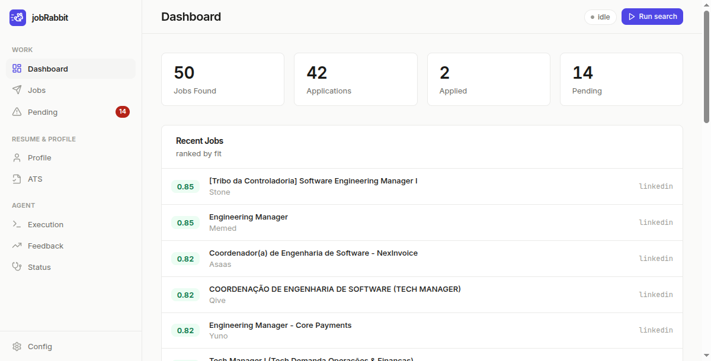
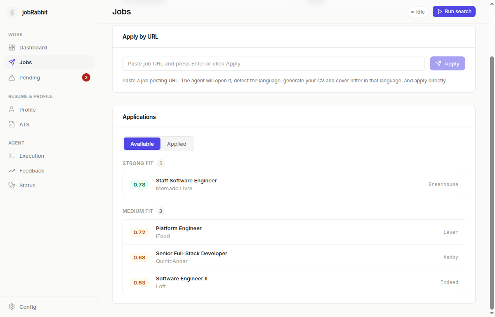
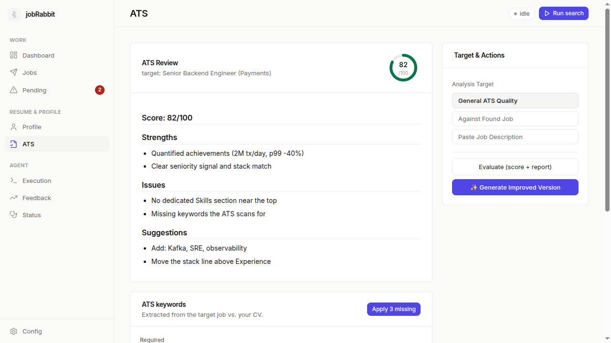
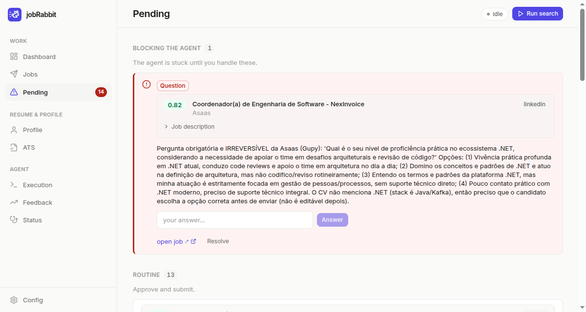

<div align="center">

<picture>
  <source media="(prefers-color-scheme: dark)" srcset="assets/brand/banner-dark.png">
  
</picture>

**Auto-apply to jobs from your terminal — driven by Claude Code + your real Chrome.**

**English** · [Português 🇧🇷](README.pt-BR.md)

[](https://github.com/renanmpimentel/jobrabbit/actions/workflows/ci.yml)
[](LICENSE)
[](#-developers)
[](#-platform-notes)
[](#-language)

</div>

jobRabbit drives the **Claude Code CLI** through the **Claude in Chrome** extension: it browses
job sites in your *already-logged-in* Chrome, scores how well each role fits your profile,
writes a tailored CV and cover letter, and applies for you — pausing to ask when it hits a
captcha, a login, or a question it can't answer. One **Rust binary** runs on Linux, macOS and
Windows, with a polished **web UI** (default) or a classic **terminal UI** (`--tui`).

<div align="center">

 
 

</div>

## ✨ What it does

- 🤖 **Applies in your real browser.** Drives Claude in Chrome — your logged-in session, no headless, no Playwright.
- 📄 **Builds your profile for you.** Import from a **résumé** (PDF/DOCX/TXT) or your **LinkedIn URL**.
- 🎯 **Scores every job 0–1** against your profile (seniority, stack, work model, requirements).
- 🧩 **Knows 12 ATS platforms** — Gupy, LinkedIn, Greenhouse, Lever, Workday, Ashby, SmartRecruiters, Indeed, Solides, Vagas.com.br, InfoJobs, inHire — with per-site recipes.
- 🛡️ **Human-in-the-loop by default.** It always stops for your approval before filling or submitting — even in autonomous mode. It never bypasses captchas.
- 🔔 **Tells you when it's stuck.** Login, captcha or a screening question → in-app alert, Pending badge, and a desktop notification, with the full job context inline.
- 📊 **ATS résumé checker.** Score your CV 0–100 with a keyword-gap report you can apply in one click.
- 🌍 **Bilingual** — English by default, pt-BR selectable, for both the UI *and* the agent.

## 📋 Requirements

jobRabbit *drives* two things that must live on your desktop:

- **Claude Code CLI** — installed and logged in (run `claude` once). Get it at [claude.com/claude-code](https://claude.com/claude-code). *(Requires a paid Claude plan.)*
- **Google Chrome** + the **Claude in Chrome** extension — installed and signed in. Get it at [claude.com/claude-for-chrome](https://claude.com/claude-for-chrome).

## 🚀 Quick start

**1. Download** the file for your computer from the [latest release](https://github.com/renanmpimentel/jobrabbit/releases/latest):

| Your computer | File |
|----|------|
| **Windows** | `jobrabbit-windows-x86_64.exe` |
| **Mac** — Apple chip (M1/M2/M3/M4) | `jobrabbit-macos-arm64` |
| **Mac** — Intel chip | `jobrabbit-macos-x86_64` |
| **Linux** | `jobrabbit-linux-x86_64` |

> Not sure which Mac?  → **About This Mac**. *"Apple M…"* = Apple chip; *"Intel"* = Intel.

**2. Run it** — a tab opens in your browser with the jobRabbit dashboard. Keep the small
terminal/console window open while you use it; closing it stops jobRabbit.

- **Windows** — double-click the file. If you see *"Windows protected your PC"*, click
  **More info → Run anyway** (the app just isn't code-signed yet — it's not malware).
- **Mac** — open **Terminal** (⌘+Space, type *Terminal*) and paste:
  ```bash
  cd ~/Downloads && chmod +x jobrabbit-macos-* && ./jobrabbit-macos-*
  ```
  If macOS says *"unidentified developer"*, go to **System Settings → Privacy & Security**,
  click **Open Anyway**, and run the command again.
- **Linux** — from your Downloads folder:
  ```bash
  chmod +x jobrabbit-linux-x86_64 && ./jobrabbit-linux-x86_64
  ```

> Prefer the classic terminal UI? Add `--tui` to the command.

## 👣 Your first run

1. **Import your profile** — on the **Profile** page, click *Import profile* and point it at your
   résumé (PDF/DOCX/TXT) or paste your LinkedIn URL. The agent turns it into a background, a base
   CV, and suggested search variants.
2. **Pick where to search** — from **Config**, enable the job sources you want (12 platforms are
   seeded; add your own too).
3. **Run a search** — click **Run search**. Leave the apply mode on **review** for your first run:
   jobRabbit prepares everything and waits for your OK before it applies.

> Or import headless from the CLI: `jobrabbit --import-cv ~/resume.pdf` /
> `jobrabbit --import-linkedin https://www.linkedin.com/in/your-profile`.

## 🌍 Language

jobRabbit is English-first. Switch to **Português** from the **Config** page (web UI) or the
**Config** tab (TUI). The choice also sets the **agent's** language, so it searches the right job
boards and writes your CV and cover letters in that language.

## 💻 Platform notes

The same binary adapts to each OS; a few optional niceties differ:

| | Linux | macOS | Windows |
|---|:---:|:---:|:---:|
| Web UI + agent (core) | ✅ | ✅ | ✅ |
| Desktop notifications | ✅ (D-Bus) | ✅ | — *(silent)* |
| Auto-run when idle | ✅ | — | — |
| Secure token storage | Secret Service | Keychain | Credential Manager |
| Data & logs folder | `~/.local/share/jobrabbit/` | `~/Library/Application Support/dev.jobrabbit.jobrabbit/` | `%APPDATA%\jobrabbit\jobrabbit\data\` |

Where an item shows "—", it's simply skipped — everything else works normally.
`jobrabbit --doctor` is the fastest way to check your setup on any OS.

## 🧰 Troubleshooting

- **"`claude` not found"** — install Claude Code and log in (`claude`). Run `jobrabbit --doctor` for a full checkup.
- **Linux: binary won't start** — install the libs: `sudo apt install libxcb1 libxss1 libdbus-1-3`.
- **macOS: "unidentified developer"** — allow it in **System Settings → Privacy & Security**, or run `xattr -d com.apple.quarantine ./jobrabbit-macos-*` once.
- **Windows: no desktop notifications** — expected; the in-app alerts (toast + Pending badge) still work everywhere.
- **TUI looks broken / no colors** — use a modern terminal (256-color / UTF-8).
- **Where's my data?** — the folder in [Platform notes](#-platform-notes) (`jobrabbit.db`, `settings.json`, `jobrabbit.log`, `playbooks/<locale>/`).

## ⚠️ Responsible use

Automating job applications may conflict with a site's Terms of Service. **Check the ToS of each
job site** regarding automation — you are responsible for how you use this tool. jobRabbit keeps a
human in the loop by default (`review` mode) and never bypasses captchas.

## 🔧 Developers

<details>
<summary>Build from source, Docker, dev shortcuts, architecture and tests</summary>

### Build from source (any OS)

Requires **Rust** (stable) and **Node 20+**.

```bash
cd web-ui && npm install && npm run build && cd ..   # build the web UI (gets embedded)
cargo build --release                                # compile the binary
./target/release/jobrabbit                           # run it — jobrabbit.exe on Windows
```

On **Linux only**, install the D-Bus/X11 libs first (notifications, idle detection, TUI):

```bash
sudo apt install libxcb1 libxss1 libdbus-1-3         # Debian/Ubuntu
```

### Docker (Linux hosts, no Rust/Node needed)

Builds a **Linux** binary inside Docker (use *Build from source* for macOS/Windows):

```bash
make            # test → build the web bundle + release binary → open the web UI
./dist/jobrabbit
```

### Dev shortcuts (Docker)

```bash
make build        # compile (debug)          make web-dev   # Vite dev server (HMR) on :5173
make test         # run the tests            make release   # build ./dist/jobrabbit for the HOST
make snapshot     # render TUI as text       make fmt        # format the code
make run          # web UI (needs claude + Chrome on the host)
make tui          # classic TUI (needs a TTY)
```

### Architecture

- **Front-ends** — a local **web UI** (React + Vite + Tailwind, served by an Axum backend) and a **TUI** (ratatui/crossterm). Both compose the same core.
- **Agent** — the app spawns `claude` in a PTY and reads `--output-format stream-json`. The agent emits an **NDJSON protocol** (`job` / `application` / `pending` / `answer` / `feedback` / `profile` / `cv_review`) that the app persists to SQLite. The agent only emits events; the DB is owned by the UI loop.
- **Desktop integrations** — resolved per OS: notifications (`notify-rust`, Linux D-Bus / macOS), keyring (`keyring` v3), link opening (`xdg-open` / `open` / `start`) and Chrome discovery. Idle detection (`user-idle`) is Linux-only.
- **i18n** — UI strings in `web-ui/src/locales/{en,pt-BR}.json`; agent prompts/playbooks in `src/locale.rs` + `src/playbooks/{en,pt-br}/`.

### Tests & diagnostics

```bash
cargo test                     # 115 tests (parser, DB, protocol, prompts, sanitize, TUI) — or `make test`
jobrabbit --selftest-agent     # real E2E: runs claude (safe prompt, no browsing) through the pipeline
jobrabbit --snapshot           # preview the TUI screens as text (no TTY)
jobrabbit --doctor             # environment diagnostics (deps + config, per OS)
```

### Contributing

PRs are welcome! Good first contributions: new ATS playbooks, additional locales, and UI polish.
Keep the test suite green (`cargo test` / `make test`) and the code English-only.

Inspired by [claudia-rh](https://github.com/JohnGabie/claudia-rh) (Windows + Tauri/React).

</details>

## 📄 License

MIT — see [LICENSE](LICENSE).

<div align="center">
<sub>Built with 🐇 and <a href="https://claude.com/claude-code">Claude Code</a>.</sub>
</div>
